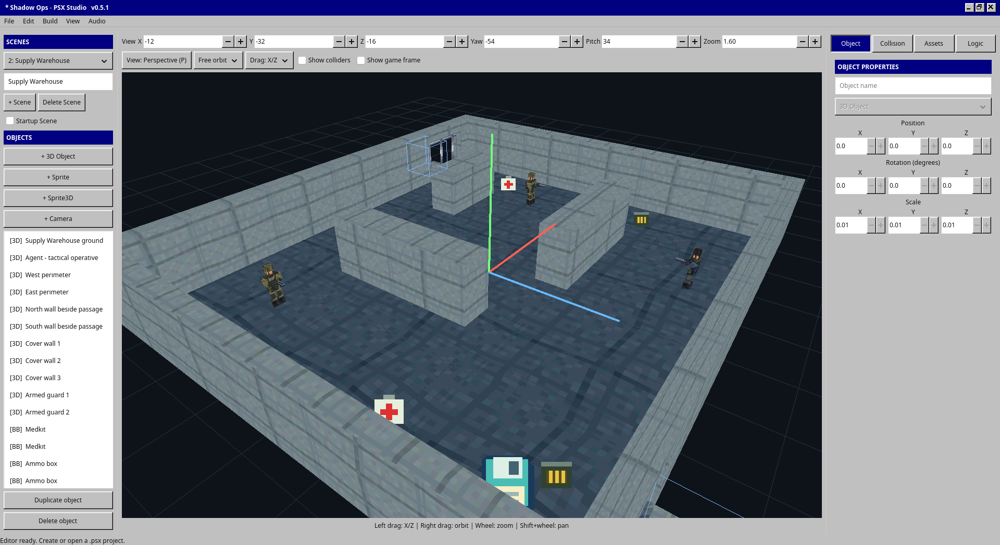

# PSX Studio

PSX Studio is a small editor for creating original PlayStation games on Linux
and Windows 11. It has a Windows 95/98-style interface, a 3D preview and a native
build pipeline that produces PS1 CD images.

Create levels, import low-poly OBJ models and PNG textures, add cameras and
collisions, and write custom gameplay in ANSI C89. WAV audio can be imported
and converted directly to the PlayStation VAG format.



## Getting started

1. Create a project and save it as a `.psx` file.
2. Add objects, import assets and arrange your level in the 3D view.
3. Set up collisions, a game camera and any custom C modules.
4. Open **File → Settings** and select your Psy-Q SDK and DOSBox executable.
5. Choose **Build → Build**, then **Run emulator** to play.

The editor view supports perspective and orthographic views. Right-drag to orbit,
scroll to zoom, and use Shift + scroll to move sideways. Select objects to edit
properties in the tabs on the right. Use Scenes to create multiple levels.

Keep `MyGame.psx` and its `MyGame_psx_data/` folder together: the folder contains
its models, textures, audio and C modules.

## What you need

To build games, supply your own **Psy-Q SDK** and **DOSBox-X or DOSBox**.
You can download the [Psy-Q SDK archive](https://psx.arthus.net/sdk/Psy-Q/PSYQ_SDK.zip)
and select the extracted SDK folder in **File → Settings**.
The SDK folder must contain `psyq/CCPSX.EXE`, `psyq/PSYMAKE.EXE`, `include/`
and `lib/`. An emulator is optional and can be configured in Settings, for example:

```text
pcsxr -cdfile {cue}
```

The SDK, DOSBox, emulator and BIOS are not included. **Python is not needed to
run PSX Studio or build games.** It is only used by development asset generators
and some automated tests.

Build results are written to `build/ps1/PROJECT/`. Open `cdrom/game.cue` in your
emulator and keep it together with `cdrom/GAME.ISO`.

## Build the editor

### Linux

Install a C11 compiler, Make, pkg-config, GTK 4.12 or newer, JSON-GLib, libepoxy
and libpng development packages. The preview requires OpenGL 3.2 or OpenGL ES 3.0.

**Ubuntu 24.04 or newer:**

```sh
sudo apt update
sudo apt install build-essential pkg-config libgtk-4-dev libjson-glib-dev libepoxy-dev libpng-dev
```

**Fedora:**

```sh
sudo dnf install gcc make pkgconf-pkg-config gtk4-devel json-glib-devel libepoxy-devel libpng-devel
```

Then, from the project folder:

```sh
make
./build/psx-studio
```

### Windows 11

Install [MSYS2](https://www.msys2.org/) and update it with `pacman -Syu` in the
**UCRT64** terminal. Reopen the terminal and repeat if prompted. Install:

```sh
pacman -S --needed make mingw-w64-ucrt-x86_64-gcc mingw-w64-ucrt-x86_64-pkgconf mingw-w64-ucrt-x86_64-gtk4 mingw-w64-ucrt-x86_64-json-glib mingw-w64-ucrt-x86_64-libepoxy mingw-w64-ucrt-x86_64-libpng mingw-w64-ucrt-x86_64-angleproject
```

Then, from PowerShell in the project folder:

```powershell
.\build.ps1
```

If script execution is blocked, run
`powershell -ExecutionPolicy Bypass -File .\build.ps1`.
Use `-Msys2 'D:\msys64'` if MSYS2 is installed somewhere other than `C:\msys64`.

The distributable folder is `build/windows/psx-studio/`. Run the executable inside
it and keep the entire folder together. It includes the required libraries;
recipients do not need MSYS2 or Python. Keep personal projects outside this
folder, as rebuilding replaces it.

On Windows, double-clicking `psx-studio.exe` opens the editor without a console
window. The package includes GLib's `gdbus.exe` session helper beside its DLLs.
Command-line output remains available when captured by scripts and the build log.

## Examples

Two ready-made projects are available in the **examples ZIP** attached to this
repository's **GitHub Releases**. They are not included in the source repository:

- **First Scene** (`first-scene.psx`): a simple two-level example with player
  movement, a following camera and Scene transitions.
- **Shadow Ops** (`shadow-ops.psx`): a tactical shooter with enemies, shooting,
  pickups, gated passages and manual memory-card checkpoints.

Download and extract the ZIP, then use **File → Open** in PSX Studio to select
either `.psx` project. Keep each project's accompanying `*_psx_data/` folder
and guide with it. Extracting into the repository folder restores `examples/`
for the example commands and integration tests in the development guides.

## Documentation and development

The README covers the basics. More detailed guides live in `docs/`:

- [Game development](docs/game-development.md): projects, Scenes and development workflow.
- [C89 modules](docs/modules.md): custom gameplay and runtime APIs.
- [Audio](docs/audio.md) and [textures](docs/textures.md): supported formats and conversion.
- [Architecture](docs/architecture.md): how the editor, exporter and runtime fit together.
- [Verification](docs/verification.md): test procedures and recorded results.

`editor/` contains the desktop application, `runtime/` the shared game code and
`pipeline/` the PS1 build resources. Keep models low poly and check performance
in an emulator. The preview is a guide, not a precise emulation of PS1 rendering.

Run `make test` on Linux or `.\build.ps1 test` on Windows for developer checks
(Python is required for these). Tests that use example projects are skipped when
the examples archive is not installed.

For a command-line game build, compile the editor first, then run:

```sh
./build/psx-studio --build-ps1 --project /path/to/MyGame.psx --psyq /path/to/psyq
```

On Windows, use `psx-studio.exe --build-ps1` with the same options.
