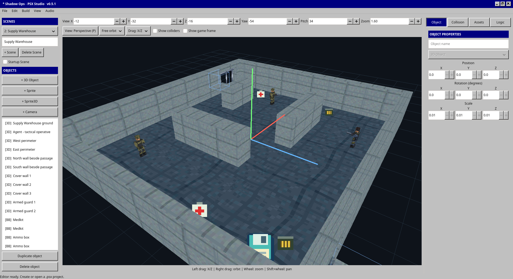
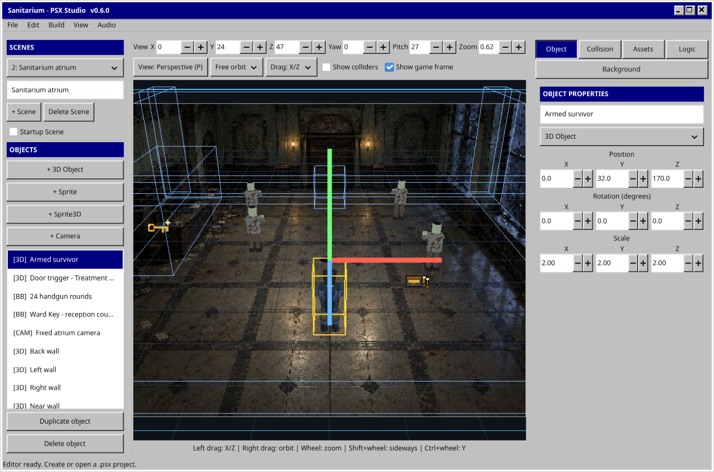

# PSX Studio

PSX Studio is a small editor for creating original PlayStation games on Linux
and Windows 11. It has a Windows 95/98-style interface, a 3D preview and a C89 exporter that builds PS1 CD images through the included PSX Lib framework.

Create levels, import low-poly OBJ models and PNG textures, add cameras and
collisions, and write custom gameplay in ANSI C89. WAV audio can be imported
and converted directly to the PlayStation VAG format.





## Getting started

1. Create a project and save it as a `.psx` file.
2. Add objects, import assets and arrange your level in the 3D view.
3. Set up collisions, a game camera and any custom C modules.
4. Open **File → Settings** and select your Psy-Q SDK folder and configure an emulator if desired.
5. Choose **Build → Build**, then **Run emulator** to play.

A Scene can also use a pre-rendered PNG background: choose **Background...** in
the **Background** tab on the right, then align a fixed 3D camera with the image. Actors and
collisions continue to use the normal 3D runtime. Use **Add layer...** for
transparent foreground PNGs and set **Layer depth** to let actors pass behind
painted counters or pillars.

The editor view supports perspective and orthographic views. Right-drag to orbit,
scroll to zoom, Shift + scroll to move sideways, and Ctrl + scroll to move
along the Y axis. Select objects to edit
properties in the tabs on the right. Clicking a model selects its surface;
overlapping objects select the nearest surface, and transparent sprite pixels
let clicks through. Use Scenes to create multiple levels.

Keep `MyGame.psx` and its `MyGame_psx_data/` folder together: the folder contains
its models, textures, audio and C modules.

## What you need

**PSX Lib is included in `psx-lib/`** and Studio finds it automatically. Supply
your own **Psy-Q SDK** and put **dosbox-x** in the system `PATH`. There is no
framework path setting. Running `make` builds both components; `make lib` builds
only the headless framework. Keep the framework runtime/build resources with
its executable when distributing it.

Select the SDK folder containing `psyq/CCPSX.EXE`, `psyq/PSYMAKE.EXE`, `include/`
and `lib/`. Studio passes this path to the engine; the engine owns SDK use,
DOSBox-X configuration, compilation, caching and CD verification.
An emulator is optional and can be configured in Settings, for example:

```text
pcsxr -cdfile {cue}
```

The SDK, DOSBox-X, emulator and BIOS are not included. **Python is not needed to
run PSX Studio or build games.** It is only used by development asset generators
and some automated tests.

Generated C projects are written to `build/studio-projects/NAME-HASH/source/`.
Build results are written to `build/engine/ps1/NAME-HASH/`. Open `cdrom/game.cue` in your
emulator and keep it together with `cdrom/GAME.ISO`.

## Editor and framework boundary

Studio owns `.psx` authoring, scene/object/collision definitions, native asset
conversion, and C89 application generation. It passes generated C, a C resource list and snapshotted assets
to PSX Lib's direct-C interface. The engine never receives a `.psx` file.
Rendering, rigid-part animation transforms, simulation, sound, input and console
backends come from the included framework; Studio has no second PS1 runtime.
C modules include the engine's public headers, such as `object.h`.

Export a standalone C project without running the SDK:

```sh
./build/psx-studio --export path/to/game.psx --output path/to/export
./psx-lib/build/psx-lib --build-ps1 --source-root path/to/export --name my-game \
  --build-directory path/to/game-build --max-objects 512 --render-triangles 8192 \
  --resources path/to/export/reslist.h --asset-root path/to/export/resources \
  --psyq path/to/psyq
```

Choose an empty export folder; subsequent exports prune only files recorded as
Studio-owned. `assets.json` records the actual largest Scene object count, which
Studio passes automatically during normal builds. The conservative 512 above
also works for manual builds.

The format remains version 3. Old projects load, but C modules using the former
Studio HUD/inventory fields must migrate to engine overlay APIs. See
[modules](spec/modules.md) and [validation and limitations](spec/game-development.md).

## Build the editor

The root Makefile coordinates two independent components:

| Command | Action |
| --- | --- |
| `make` | Build PSX Lib and Studio |
| `make studio` | Build the editor only |
| `make lib` | Build PSX Lib only; no GTK required |
| `make test` | Run framework and editor/integration tests |
| `make test-studio` / `make test-lib` | Run either suite |
| `make clean` | Clean both generated build folders |
| `make -C psx-lib` | Build the framework independently |

For C-only development, start with [psx-lib/examples/c-starter](psx-lib/examples/c-starter).
The folder `psx-lib/` can be copied and built on its own. Its Makefile, runtime,
resource converters and SDK pipeline do not require the editor or parent Makefile.
Read [PSX Lib usage](psx-lib/README.md) and the [framework reference](spec/framework.md).
Development instructions live in one root `AGENTS.md` and `spec.md`.

### Linux

Install a C11 compiler, Make, pkg-config, GTK 4.12 or newer, JSON-GLib, libepoxy
and libpng development packages. The preview requires OpenGL 3.2 or OpenGL ES 3.0.

**Ubuntu 24.04 or newer:**

```sh
sudo apt update
sudo apt install build-essential pkg-config libgtk-4-dev libjson-glib-dev libepoxy-dev libpng-dev
```

**Fedora:**

```sh
sudo dnf install gcc make pkgconf-pkg-config gtk4-devel json-glib-devel libepoxy-devel libpng-devel
```

Then, from the project folder:

```sh
make
./build/psx-studio
```

### Windows 11

Install [MSYS2](https://www.msys2.org/) and update it with `pacman -Syu` in the
**UCRT64** terminal. Reopen the terminal and repeat if prompted. Install:

```sh
pacman -S --needed make mingw-w64-ucrt-x86_64-gcc mingw-w64-ucrt-x86_64-pkgconf mingw-w64-ucrt-x86_64-gtk4 mingw-w64-ucrt-x86_64-json-glib mingw-w64-ucrt-x86_64-libepoxy mingw-w64-ucrt-x86_64-libpng mingw-w64-ucrt-x86_64-angleproject
```

Then, from PowerShell in the project folder:

```powershell
.\build.ps1
```

If script execution is blocked, run
`powershell -ExecutionPolicy Bypass -File .\build.ps1`.
Use `-Msys2 'D:\msys64'` if MSYS2 is installed somewhere other than `C:\msys64`.

The distributable folder is `build/windows/psx-studio/`. Run the executable inside
it and keep the entire folder together, including `psx-lib.exe` and the
`psx-lib/` runtime/build resources. It includes the required libraries;
recipients do not need MSYS2 or Python. Keep personal projects outside this
folder, as rebuilding replaces it.

On Windows, double-clicking `psx-studio.exe` opens the editor without a console
window. The package includes GLib's `gdbus.exe` session helper beside its DLLs.
Command-line output remains available when captured by scripts and the build log.

## Examples

Example projects are distributed separately in the **examples ZIP** attached to
this repository's **GitHub Releases**, rather than in the source repository:

- **Shadow Ops** (`shadow-ops.psx`): a tactical shooter with enemies, shooting,
  pickups, gated passages and manual memory-card checkpoints.
- **Sanitarium** (`sanitarium.psx`): an original fixed-camera sanitarium demo with
  pre-rendered backgrounds, an armed 3D survivor, five connected rooms with
  different fixed camera angles, twenty zombies and pixel-art blood impacts. A compact graphical inventory carries a
  glinting Sprite3D counter key used to unlock the ward. Press Cross at editable
  door triggers to travel
  between rooms while preserving inventory, health, ammunition and defeated enemies.
  Surviving enemies restart at their spawn points when an area is revisited.
  Ammo Sprite3Ds are scattered through the rooms, and the pharmacy demonstrates
  a transparent counter layer that occludes actors at the correct depth.

Download and extract the ZIP, then use **File → Open** in PSX Studio to select
a `.psx` project. Keep each project's accompanying `*_psx_data/` folder
and guide with it. Extracting into the repository folder restores `examples/`
for the example commands and integration tests in the development guides.

## Documentation and development

The README covers the basics. More detailed guides live in `spec/`:

- [Game development](spec/game-development.md): projects, Scenes, development workflow and verification.
- [C89 modules](spec/modules.md): custom gameplay and runtime APIs.
- [Audio](spec/audio.md) and [textures](spec/textures.md): supported formats and conversion.
- [Architecture](spec/architecture.md): how the editor, exporter and runtime fit together.

`editor/` contains the desktop application and C89 exporter. PS1 runtime and
build resources belong to `psx-lib/`. Keep models low poly and check performance
in an emulator. The preview is a guide, not a precise emulation of PS1 rendering.

Run `make test` on Linux or `.\build.ps1 test` on Windows for developer checks
(Python is required for these). Tests that use example projects are skipped when
the examples archive is not installed.

For a command-line game build, compile the editor first, then run:

```sh
./build/psx-studio --build-ps1 --project /path/to/MyGame.psx --psyq /path/to/psyq
```

On Windows, use `psx-studio.exe --build-ps1` with the same options.
